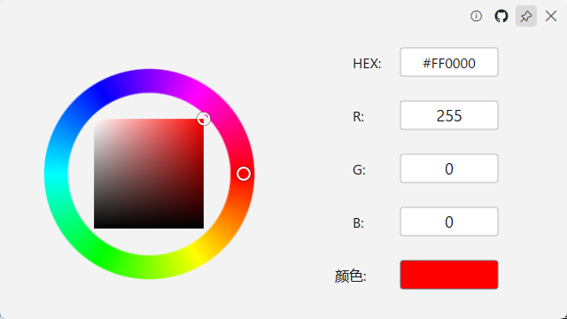

# GpuColorLite

一个轻量的 NVIDIA 显卡 RGB 灯效控制工具。通过 NVAPI I2C 直接写入 GPU 灯效寄存器，界面完全由 Direct2D 自绘，**单文件、零外部运行时依赖**。

<p align="center">
  
</p>

---

## 特性

- **色相环 + 饱和度/明度方块**，支持 HEX / R / G / B 精确输入
- **深浅色自动跟随系统**（`AppsUseLightTheme`，实时响应 `WM_SETTINGCHANGE`）
- **无边框自绘窗口**：无系统标题栏与边框，保留 DWM 阴影、圆角与系统开关动画
- **状态持久化**：注册表保存 HSV + RGB，灰色/黑色也能精确恢复
- **单文件分发**：静态链接 CRT，仅依赖系统自带的 `d2d1 / dwrite / dwmapi` 等
- **可嵌入**：额外提供 DLL 版本，供其他程序调用

## 系统要求

| 项目 | 要求 |
|---|---|
| 操作系统 | Windows 10 1809+ / Windows 11 |
| 显卡 | NVIDIA（需 `nvapi64.dll`，随驱动安装） |
| 运行时 | 无额外依赖 |

## 测试环境与兼容性

**本项目仅在以下单一配置上实测通过：**

| 项目 | 配置 |
|---|---|
| 操作系统 | Windows 11 专业版 25H2（Build 26200） |
| 显卡 | 七彩虹 iGame GeForce RTX 5060 Ultra —— **侧边灯条** |
| 显卡驱动 | 32.0.16.1664 |
| NVAPI | `nvapi64.dll` 32.0.16.1664 |

> ### ⚠️ 关于兼容性
>
> 本工具是**专门针对七彩虹 iGame Ultra 系列显卡的侧边灯条**开发的。
>
> 灯效控制通过 NVAPI 的 I2C 接口向显卡写入厂商私有报文：
>
> ```
> 0xAA 0xEF 0x12 0x03 0x01 0xFF R G B + 16 位校验
> I2C 设备地址 0xC2
> ```
>
> 这套报文格式**并非公开标准**，而是从上述型号逆向实测得出。
>
> **其他品牌、其他型号的显卡均未做任何测试。** 即便同为 NVIDIA GPU，不同厂商（华硕 / 微星 / 技嘉 / 影驰 / 索泰等）、乃至同厂商的不同系列，其灯效控制器、I2C 地址与报文格式都可能不同，直接使用可能出现：
>
> - **无效果** —— 写入返回成功但灯不亮
> - **颜色错误** —— 通道顺序或位深不一致
> - **意外行为** —— 极少数情况下可能影响同一 I2C 总线上的其他设备
>
> 使用前请自行评估风险。如果你在其他型号上测试成功，欢迎提交 Issue 说明型号与结果，帮助完善兼容性列表。

## 编译

需要 **Visual Studio 2022 Build Tools**（MSVC v143 + Windows SDK 10）。

```bat
:: 编译可执行程序 -> output\GpuColorLite.exe
build.bat

:: 编译动态库 -> output\GpuColorLite.dll + .lib + .h
build_dll.bat
```

两个脚本会自动定位 `vswhere.exe`、调用 `vcvars64.bat`、查找 SDK 中的 C++/WinRT 头文件，无需手动配置环境。

## 使用

### 图形界面

双击 `GpuColorLite.exe`：

- 拖动色相环改变色相，拖动中心方块改变饱和度与明度
- 点击 `HEX` / `R` / `G` / `B` 输入框可直接键入数值，回车生效
- 右上角按钮：**关于** / **GitHub** / **置顶** / **关闭**
- 松开鼠标或回车后自动应用到显卡并保存

### 命令行

```bat
GpuColorLite.exe 255 0 0          :: 直接设置颜色（0-255）
GpuColorLite.exe --hex FF0000     :: 十六进制设置
GpuColorLite.exe --off            :: 关闭灯效
GpuColorLite.exe --shot out.png   :: 离屏渲染一帧 PNG
GpuColorLite.exe --light          :: 强制浅色主题
GpuColorLite.exe --dark           :: 强制深色主题
```

### DLL 集成

`build_dll.bat` 会在 `output\` 下生成 `GpuColorLite.dll`、`GpuColorLite.lib` 和 `GpuColorLite.h`。

**C / C++（静态链接导入库）**

```cpp
#include "GpuColorLite.h"

if (GclSetColor(255, 0, 0) != 0) {
    printf("失败: %s\n", GclLastError());
}
```

**C#（P/Invoke）**

```csharp
using System.Runtime.InteropServices;

internal static class GpuColorLite
{
    [DllImport("GpuColorLite.dll")]
    public static extern int GclSetColor(byte r, byte g, byte b);

    [DllImport("GpuColorLite.dll")]
    public static extern int GclSaveHsv(uint hue, uint sat, uint val);

    [DllImport("GpuColorLite.dll")]
    public static extern IntPtr GclLastError();
}

GpuColorLite.GclSetColor(0, 120, 255);
```

**Python（ctypes）**

```python
import ctypes

dll = ctypes.WinDLL("GpuColorLite.dll")
if dll.GclSetColor(255, 0, 0) != 0:
    print(dll.GclLastError())
```

#### 导出接口

| 函数 | 说明 |
|---|---|
| `int GclSetColor(u8 r, u8 g, u8 b)` | 设置 GPU 灯效颜色 |
| `int GclSaveHsv(u32 h, u32 s, u32 v)` | 保存 HSV（h `0..359`，s/v `0..1000`） |
| `int GclLoadHsv(u32* h, u32* s, u32* v)` | 读取 HSV |
| `int GclSaveRgb(u8 r, u8 g, u8 b)` | 保存 RGB |
| `int GclLoadRgb(u8* r, u8* g, u8* b)` | 读取 RGB |
| `const char* GclLastError()` | 最近一次失败原因（UTF-8，内部持有） |
| `const char* GclVersion()` | 版本号 |

所有函数返回 `0` 表示成功，非 `0` 表示失败。

## 已知限制

- **仅针对七彩虹 iGame Ultra 系列（RTX 5060 Ultra 侧边灯条）实测**，其他品牌 / 型号未验证，详见上方「测试环境与兼容性」
- 仅支持 NVIDIA 显卡，且需要驱动提供的 `nvapi64.dll`
- 若 iGame Center / iGC.Lite 等工具正在占用 I2C，写入可能失败（关闭后重试）
- 动画完全由系统 DWM 提供，需系统「动画效果」开启

## 项目结构

```
GpuColorLite/
├── GpuColorLite.cpp     单文件源码（UI + NVAPI 后端 + DLL 导出）
├── app.rc               资源脚本（图标 + 版本信息）
├── Zerin.ico            应用图标
├── build.bat            编译 EXE
├── build_dll.bat        编译 DLL
├── LICENSE
└── output/              编译产物（EXE / DLL / LIB / H）
```

## 许可证

[MIT License](LICENSE)
